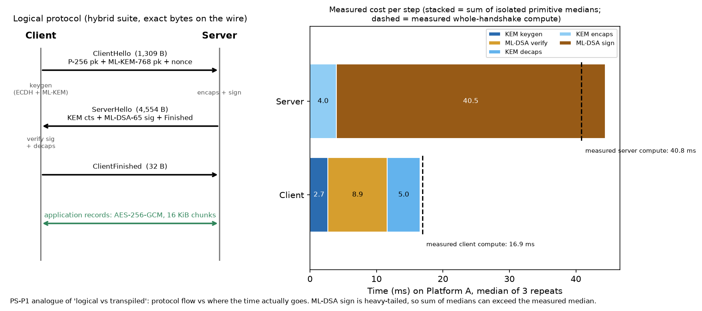
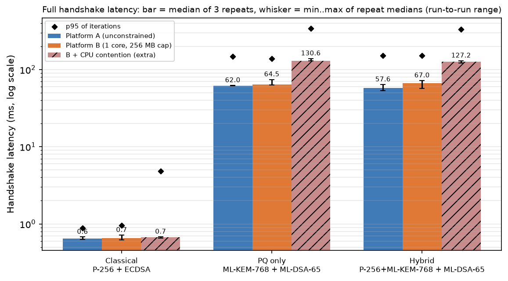
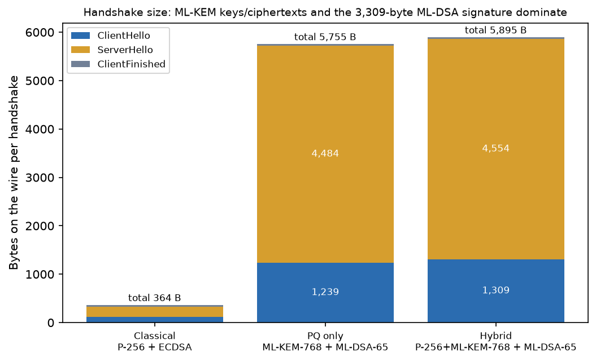
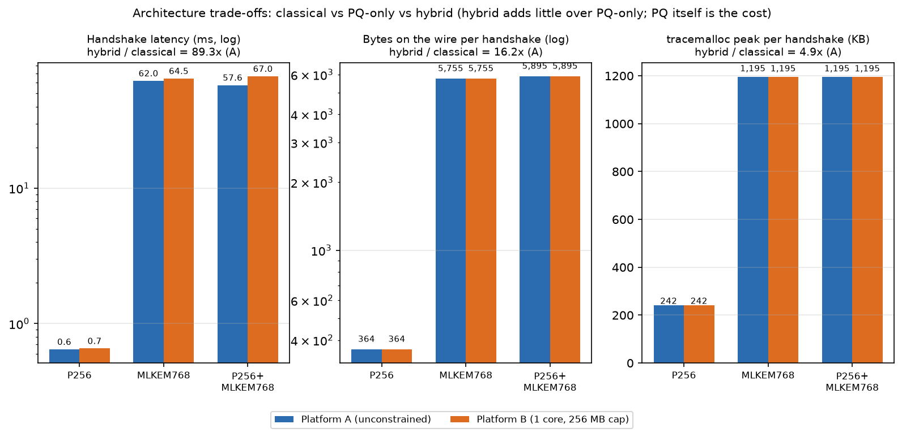
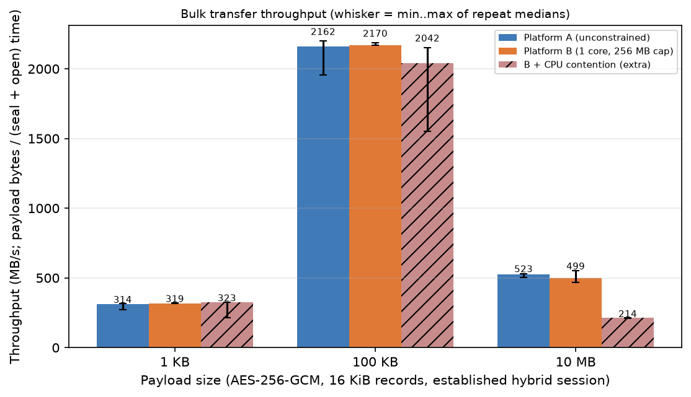
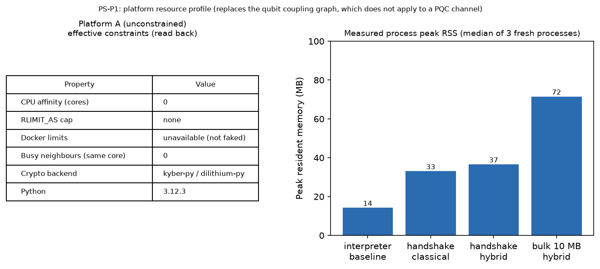
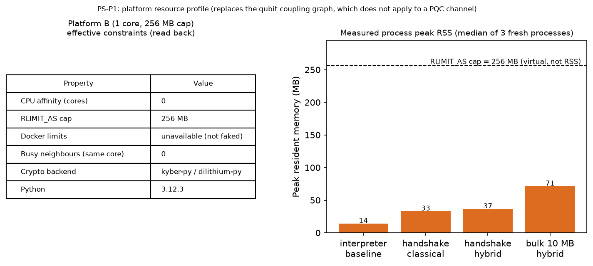

# P1 — Quantum-Safe Secure Communication Channel: Report

Problem **P1** (Track 5, Post-Quantum Cryptography). All numbers below come from `results/tables/*.csv`
(regenerate everything with `make all`; `python scripts/spot_check_report.py` re-derives the quoted values independently).

## 1. Summary

We built a 1-round-trip, server-authenticated secure channel with a **hybrid key exchange (ECDH P-256 + ML-KEM-768)**,
**ML-DSA-65** transcript signatures, **HKDF-SHA256** key derivation and an **AES-256-GCM** record layer, using only vetted
library primitives (`cryptography 50.0.2; kyber-py 1.2.0; dilithium-py 1.5.1`). We benchmarked it against a classical baseline (P-256 + ECDSA) and a PQ-only baseline on
**Platform A** (unconstrained) and **Platform B** (1-core affinity + 256 MB address-space cap), 3 independent process repeats ×
100 timed iterations.

Headline results (hybrid suite, medians):

* **Handshake on the wire:** 5,895 B (client→server 1,341 B,
  server→client 4,554 B) versus 364 B classical
  = **16.2x**; only **+140 B (2.4 %)** over PQ-only.
* **Handshake latency:** 57.6 ms on A vs 67.0 ms on B (classical: 0.65 ms on A). The A-vs-B gap is within run-to-run noise (section 5).
* **A vs B:** Only 1 of 25 A-vs-B comparisons exceed their own run-to-run noise: MLDSA65/sign (0.88x). All others are indistinguishable from noise. With this many comparisons, a few exceedances are expected by chance even when there is no true difference, and the exceeding direction here is B *faster*, which a constraint cannot plausibly cause.
* **Memory:** 1,195 KB traced peak per hybrid handshake;
  process peak RSS 36.6 MB (handshake) / 71.5 MB (10 MB bulk).
* **Correctness evidence:** 84 automated tests (sizes vs FIPS values, independent ML-KEM cross-check, tamper/replay/MITM/downgrade tests, an unauthenticated-MITM negative control), see section 3.

## 2. Method

**Protocol** (`src/channel.py`): ClientHello (version, suite id, nonce, KEM public key) → ServerHello (KEM ciphertext, ML-DSA-65
signature over the SHA-256 transcript hash, Finished MAC) → ClientFinished. Keys: `HKDF-Extract(salt = nonce_c‖nonce_s, ikm = hybrid secret)`,
then separate Expand labels for client→server key, server→client key, nonce prefixes and the Finished key. The hybrid secret is
`HKDF(ikm = ss_ecdh ‖ ss_mlkem, info = label ‖ all public values)`. Records are ≤ 16 KiB, AAD = direction ‖ sequence ‖ length, nonces are counters (never random).
See `figures: logical_vs_transpiled.png` and `docs/THREAT_MODEL.md`.



**Platforms** (`processors/*.json`, `src/processors.py`, `src/routing.py`). Each benchmark repeat runs in a **fresh subprocess**
that applies its constraints *before* importing the crypto libraries and records the values read back (they are in every CSV row).

| | Platform A | Platform B | B contended (extra, D11) |
|---|---|---|---|
| CPU affinity (effective) | 0 | 0 | 0 |
| RLIMIT_AS | none | 256 MB | 256 MB |
| Busy-loop neighbours on same core | 0 | 0 | 1 |
| Docker `--cpus/--memory` | not available | not available | not available |

**Important honesty note.** This sandbox has **one CPU core and no Docker**, so pinning B to core 0 does **not** reduce its CPU relative to A.
The only genuine A/B difference in the required experiment is the 256 MB address-space cap. To still obtain a real CPU-constrained condition
we added an **extra, clearly labelled** experiment, *B contended*: a busy-loop process pinned to the same core, so the benchmark receives roughly half of the CPU.
This is real contention, not a scaled or faked number, but it is still an emulation on the same host, not real constrained hardware.

**Measurement.** `time.perf_counter_ns`, GC disabled inside timed loops, 10 warm-up + 100 timed iterations (10 MB payload: 2 + 10), 3 independent
process repeats, median/IQR/p95 per repeat. Latency and memory are **separate passes** (tracemalloc inflates run time); memory scenarios each run in a fresh process.
Competing suites/primitives are timed **interleaved with rotating order** so host drift cannot favour one suite (see `docs/BUGLOG.md`).
Peak RSS is read from `/proc/self/status` (`VmHWM`) because `ru_maxrss` wrongly includes the parent's high-water mark after `exec`.
Keys use OS randomness, so results are statistically, not bit-for-bit, reproducible; seed 42 only generates payload bytes.

## 3. Correctness evidence

84 tests pass (`make test`). Highlights:

* Sizes asserted against FIPS values: ML-KEM-768 pk 1184 / ct 1088 / sk 2400, ML-DSA-65 pk 1952 / sig 3309, P-256 point 65.
* ML-KEM backend (`kyber-py`) interoperates with an independent implementation (`mlkem`) in both directions; a wrong-key negative control fails as it must.
* Hybrid combiner: replacing **only** the ECDH share or **only** the ML-KEM share changes the session key; tampered ML-KEM ciphertext gives a different key (implicit rejection) without an exception.
* Handshake: signature verified before key use; every one of ≥ 30 single-bit tampers over all three messages is rejected; downgrade to a classical suite is rejected;
  a signed MITM (fake server or KEM substitution) is rejected; record tamper / drop / reorder / replay are rejected.
* **Negative control:** with authentication disabled, the MITM attack *succeeds* (attacker reads and relays plaintext) — which is why the signature is mandatory.
* Payloads 1 KB / 100 KB / 10 MB (and 0, 1, 16384, 16385 bytes) round-trip byte-exactly (SHA-256).

## 4. Results



| Metric | Platform A | Platform B | Difference | Platform B contended (extra) | Difference (contended vs A) |
|---|---|---|---|---|---|
| Handshake latency, hybrid (ms, median) | 57.623 | 66.978 | +9.36 (1.16x) | 127.235 | +69.61 (2.21x) |
| Handshake bytes c2s+s2c, hybrid (bytes) | 5895.0 | 5895.0 | +0.00 (1.00x) | 5895.0 | +0.00 (1.00x) |
| Ciphertext size, hybrid KEM (bytes) | 1153.0 | 1153.0 | +0.00 (1.00x) | 1153.0 | +0.00 (1.00x) |
| Peak memory, hybrid handshake: tracemalloc (KB) | 1194.779 | 1194.59 | -0.19 (1.00x) | 1194.645 | -0.13 (1.00x) |
| Peak RSS, hybrid handshake process (MB) | 36.598 | 36.578 | -0.02 (1.00x) | 36.5 | -0.10 (1.00x) |
| Peak RSS, 10 MB bulk process (MB) | 71.516 | 71.305 | -0.21 (1.00x) | 71.414 | -0.10 (1.00x) |
| Throughput, 10 MB payload (MB/s) | 523.19 | 499.005 | -24.19 (0.95x) | 213.722 | -309.47 (0.41x) |
| Code size, src/ (LOC, non-blank non-comment) | 730.0 | 730.0 | +0.00 (1.00x) | 730.0 | +0.00 (1.00x) |

*Difference = B − A (and B/A). Code size is the same on both platforms by construction. Memory values: tracemalloc peak is per handshake; RSS peaks include
about 14.2 MB of interpreter baseline and the imported libraries, so they differ little between scenarios except for the 10 MB payload.*

Per-suite handshake latency (median of 3 repeats, ms):

| Suite | A | B | B contended (extra) |
|---|---|---|---|
| Classical (P-256 + ECDSA) | 0.65 | 0.65 | 0.67 |
| PQ only (ML-KEM-768 + ML-DSA-65) | 62.0 | 64.5 | 130.6 |
| Hybrid (P-256+ML-KEM-768 + ML-DSA-65) | 57.6 | 67.0 | 127.2 |







## 5. Interpretation

1. **What changed between A and B?** Only constraints. B is pinned to core 0 and capped at 256 MB of address space; on this single-core host the pin changes nothing for CPU,
   so the cap is the only effective difference. Algorithm, backend, versions, iterations and seed are identical (checked by `scripts/check_repo.py`).
2. **Which platform property changed?** Memory ceiling only (A vs B). Every workload completed under the cap (peak RSS ≤ 72 MB; note `RLIMIT_AS` limits *virtual address space*, which is larger than RSS), so the cap did not constrain this workload. In the extra experiment the property that changed is **CPU share**.
3. **Did the handshake slow down, and which step dominates?** Only 1 of 25 A-vs-B comparisons exceed their own run-to-run noise: MLDSA65/sign (0.88x). All others are indistinguishable from noise. With this many comparisons, a few exceedances are expected by chance even when there is no true difference, and the exceeding direction here is B *faster*, which a constraint cannot plausibly cause. Across all 25 A/B comparisons the B/A ratio has median 1.01 (range 0.88–1.17).
   The headline hybrid handshake reads 1.16x slower on B, but its run-to-run spread is about 20 % on both platforms and the per-repeat ranges
   overlap (A: 53.1–64.1 ms, B: 56.8–72.1 ms), so we do not claim a real slowdown.
   **Dominant step:** ML-DSA-65 signing on the server (median 40.5 ms) which accounts for most of the server's measured compute (40.8 ms hybrid, 43.8 ms PQ-only; medians of separately measured, heavy-tailed quantities, so we do not quote a percentage); on the client ML-DSA verification (8.9 ms) is the largest part.
   ML-KEM-768 keygen/encaps/decaps medians are 2.7 / 3.8 / 4.8 ms. ML-DSA signing uses rejection sampling, so its time is heavy-tailed, which also explains the large p95 values.
4. **Extra bytes from hybrid vs classical?** +5,531 B (16.2x): the ML-KEM-768 public key (1,184 B) and ciphertext (1,088 B) plus the ML-DSA-65 signature (3,309 B versus a 64-byte ECDSA signature).
   Hybrid vs PQ-only adds only the two P-256 points (+130 B) and a longer suite id (+10 B) = +140 B.
5. **Did sizes change between platforms?** No: byte counts are identical on A, B and contended, as they must be — sizes are a property of the algorithms and framing, not of the CPU or memory budget.
6. **Could host noise / backend implementation also contribute?** Yes, strongly. 10 of 25 comparisons carry more than 20 % run-to-run spread on this shared virtual host.
   The PQ code is pure Python while ECDH/AES come from OpenSSL-backed `cryptography`: hybrid keygen is 47x slower than classical keygen mainly because of
   this implementation difference, **not** because ML-KEM is inherently that much slower; an optimised C backend (liboqs) would change the absolute numbers considerably (not measured here).
   Paired timing shows hybrid ≈ PQ-only at the primitive level (hybrid/PQ median ratio keygen 1.02, encaps 1.03, decaps 1.03); the P-256 ECDH operations cost only 0.06–0.18 ms, below the noise floor, so handshake-level hybrid-vs-PQ differences are not resolvable.
7. **Extra experiment (CPU contention).** With a competing busy loop, the PQ and hybrid handshakes take 2.11x and 2.21x the time of A, and 10 MB throughput falls to
   0.41x (214 vs 523 MB/s). The classical handshake (0.65 ms) and the 1 KB / 100 KB transfers
   (314 / 2162 MB/s on A vs 323 / 2042 on contended) show **no median slowdown**. A consistent (not separately proven) explanation: those operations are shorter than a scheduler time slice,
   so most iterations run un-preempted, which appears only in their tails (classical contended p95 = 4.9 ms vs 0.88 ms on A).
   Take-away: for CPU-starved devices, long-running PQ operations are the ones that suffer.
8. **What remains uncertain?** Behaviour on real constrained hardware (ARM cores, caches, frequency scaling), network latency/loss, a compiled backend, side-channel behaviour of the pure-Python libraries,
   and why 10 MB throughput (523 MB/s) is far below 100 KB throughput (2162 MB/s) (we suspect cache effects and Python copying of large buffers; not tested).

## 6. Trade-offs

* **Cost of PQ at all:** versus classical, hybrid costs 16.2x the handshake bytes and ~89x the handshake time in this pure-Python setup — acceptable for a once-per-connection handshake,
  more painful for very short-lived connections or constrained links.
* **Cost of hybrid over PQ-only:** +2.4 % bytes, negligible compute, identical memory — a cheap premium.
* **Benefit of hybrid:** recorded traffic stays confidential unless **both** P-256 ECDH and ML-KEM-768 fail, hedging a future quantum computer (harvest-now-decrypt-later) *and* a flaw in a young algorithm.
* **When it is worth it on constrained devices:** when long-lived confidentiality matters and handshakes are infrequent. Bulk encryption cost (AES-GCM) is independent of the PQ choice.

## 7. Limitations

* Platform B is an **emulation on one host**; CPU throttling via Docker/cgroups was not available; the contended run is an extra experiment, not part of the required A/B definition.
* PQ libraries are pure Python research code: **not constant-time, not for production**; absolute latencies are not representative of optimised implementations.
* Shared virtual host: considerable run-to-run noise (see `results/tables/spread_flags.csv`); only 3 process repeats.
* In-memory transport: no network latency, loss or TCP effects. No PKI/revocation (server key is pinned), server-only authentication.
* Python 3.12.3; versions: cryptography 50.0.2; kyber-py 1.2.0; dilithium-py 1.5.1.

## 8. Reproduction

```bash
python -m venv .venv && . .venv/bin/activate
pip install -r requirements.txt
make test          # 84 tests
make bench         # ~6 minutes; writes results/tables/*.csv  (python scripts/bench_all.py --quick for a fast smoke run)
make figures       # results/figures/*.png
python scripts/build_report.py && python scripts/spot_check_report.py && python scripts/check_repo.py
```
